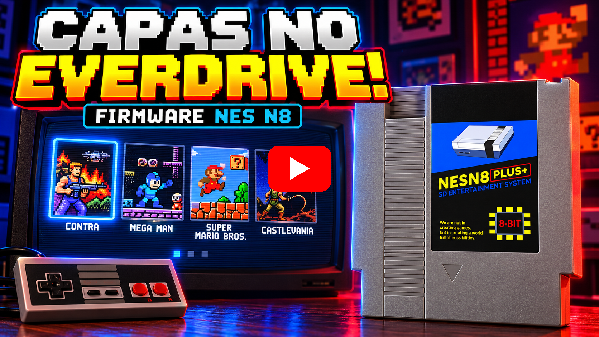

  <a href="./README.md">Português</a> |
  <strong>English</strong> |
  <a href="./README-ES.md">Español</a>

# Custom Firmware for EverDrive NES N8

This firmware displays the **game cover** beside the game list in the **EverDrive N8** browser for NES. A companion program converts cover images for the NES and generates the cartridge firmware files (`OS.BIN` + `COVERS.BIN`), ready to copy to the SD card.

## 🎥 Video demonstration

  

## Custom Firmware and Tool Features

- **112×160-pixel** cover to the right of the list, using NES background tiles and up to 62 sprites
- **20 games per page**, matching the cover height
- **← →** change pages with the cursor at the top (the original firmware kept the cursor's position from the previous page)
- A cover loads only after the cursor **stops** on a game for a configurable delay; any button cancels loading
- **Per-cover** adjustments: sharpness, dithering, sprite flicker (7 levels), and color replacement with an eyedropper
- Automatic ROM ↔ image matching by filename
- Add **new** covers to an existing `COVERS.BIN` without converting the old ones again

---

## Requirements

- An **EverDrive N8 clone** with the `EDFC` folder on its SD card.
- Cover images in **PNG** format (see [Cover Images](#cover-images)).

> ⚠️ **Back up the `EDFC` folder on your card first**, especially the original `OS.BIN`. The tool writes a modified `OS.BIN`; restore the original by copying your backup back to the card.

---

## Installation

1. Download `NES N8 Covers Editor.zip` from the *Releases* page.
2. Extract it to any folder.
3. Open **`NES N8 Covers Editor.exe`**.

Note: The tool's cache is stored at **`%APPDATA%\NES N8 Covers editor\`**.

---

## How to Use

### 1. Covers, ROMs, and output
- **Cover image folder (PNG):** the folder containing your images.
- **ROM folders (.nes):** where your ROMs are stored. You can select the SD card itself (for example, `F:\`); subfolders are scanned too. Each ROM is matched with the image whose name is most similar.
- **Output folder:** where the firmware files are generated.
- **Add new covers to COVERS.BIN only:** select a previously generated `COVERS.BIN`. Existing covers remain unchanged; only new ROMs are converted. A copy of the previous file is saved as `<output>\COVERS_previous.BIN`.

In the list on the left, **“Show covers for my ROMs only”** filters the images that will be used, and **“Show ROMs without covers…”** lists ROMs with no matching image.

### 2. Cover preview
Click a cover in the list to see how it will look on the NES.

| Option | What it does |
|---|---|
| **Delay before loading cover** | How long the cursor must stay on a game before its cover loads (0 to 4 seconds; default 0.5 seconds). Applies to all covers. |
| **Sharpness** (10–200%) | Enhances edges when reducing the image. **Set as default** applies it to covers without their own adjustment. |
| **Dithering** | Mixes two colors in a checkerboard pattern in gradients (sky, skin, shadows). It looks better on CRT/composite video, but the pattern may show with very sharp cables. |
| **Sprite flicker** + **level** | Sprites alternate between two frames at 1/60 s, and your eyes blend them for more colors and detail. Level 1 is more accurate but flickers more; level 7 flickers less. The effect varies by TV. |
| **Cover palettes / eyedropper** | Click a cover color or palette swatch to replace it with an NES color. **Undo** and **Restore originals** revert your changes. |
| **Show / zoom** | Affects only the preview (NES-style alternating frames, their average, or each frame). |

**Set as default** and **Use default for this cover** apply to flicker (on/off and level). List icons mark covers with **sharpness** or **edited colors**; “flicker” and “dithering” appear beside a game when enabled.

### 3. Generate
1. Click **GENERATE FIRMWARE**. The tool creates `<output>\EDFC\OS.BIN` and `<output>\EDFC\COVERS.BIN` (plus previews in `<output>\previews`).
2. Copy the files to the card with **Copy now**, or use **Add path…** to select the SD card so the firmware is written directly to it when generated.

> ⚠️ **Always use “Copy now” (or the SD card path).** EverDrive reads `COVERS.BIN` directly from the card's sectors, so the file must be **contiguous** (not fragmented). Copying it with Windows may split it into fragments and cause the console to **freeze when opening a folder**. The button deletes the old file, writes a contiguous one, and verifies it.

> `OS.BIN` and `COVERS.BIN` must be used together: always copy both files from the same generation.

### On the console
- Stop the cursor on a game; after the delay, its cover loads (about one second).
- Pressing any button during loading cancels it; loading starts again once the cursor stops.

---

## Cover Images

- **PNG** format, any size. The image is center-cropped to a **0.7 width-to-height ratio** (the shape of an NES game box) and resized to 112×160. Images already in this ratio are not cropped.
- Name the image after the game (for example, `Contra (USA).png`). It does not need to exactly match the ROM filename: the tool finds the closest name (`001 Contra (U).nes` can match `Contra (USA).png`). Multiple ROMs can use the same image.
- The *Named_Boxarts* sets from [libretro-thumbnails](https://github.com/libretro-thumbnails/Nintendo_-_Nintendo_Entertainment_System) are a good source of images with this naming convention.

---

## Limits

| Limit | Value | Reason |
|---|---|---|
| Covers per `COVERS.BIN` | **1015 ROMs** | The firmware uses a 16-bit address for each cover on the card. Every ROM counts, even if several share an image. |
| Items per card folder | **254** (files + subfolders) | Original cartridge firmware limit: the browser stops reading after this. For larger collections, split ROMs into subfolders (for example, `A-F`, `G-M`, …). |
| `COVERS.BIN` size | **32 KB per ROM** | 822 ROMs ≈ 26 MB. |
| Supported ROM file type | only **`.nes`** | |
| ROM filename | up to **60 characters**, **no accents** | The browser displays names in 2 lines of 30 characters; accented or longer names are skipped (a warning appears in the log). |
| ROM filename | must start with an **uppercase letter** | All-lowercase names (for example, `contra.nes`) appear incorrectly in the cartridge browser (`contanes`), and the cover will not load. Use `Contra.nes`. |
| Cover loading delay | **0 to 4 s** | |

---

## Color and Quality

The NES has a fixed palette and few colors per screen area. In the cover region:

- **Background:** 2 palettes of 3 colors selected for each cover (plus black), one palette per 16×16-pixel block.
- **Sprites:** 62 sprites with 4 palettes of 3 colors, up to 8 per line.
- **Fixed colors:** background black, list text colors, and the bar's white/gray are part of the firmware (also used by the list) and cannot be changed with the eyedropper.

**Flicker** has the biggest effect on fidelity (alternating frames effectively doubles sprite colors); **dithering** helps with gradients. Converting a cover takes about 1 second without flicker and 12 seconds with flicker. Flicker previews calculate all 7 levels in the background and show a progress bar.

---

## Known Issues

- **The console freezes when opening a folder:** `COVERS.BIN` may be fragmented on the card, or `OS.BIN` and `COVERS.BIN` may come from different generations. Copy both again with **Copy now**.
- **A game name appears joined together (for example, `contanes`) and its cover does not load:** the ROM filename is all lowercase. Rename it with an uppercase first letter (`contra.nes` → `Contra.nes`).
- **A ~0.5-second visual “static” when the console starts**, before the loading screen: the firmware prepares video memory across several banks; it goes away on its own.
- **Folders with more than 254 items** show only the first items (an original firmware limit).
- If sprite flicker is too noticeable on your TV, turn it off for that cover (or choose a higher level) and generate the files again.

---

## Credits

Made by **TavinhoGames** — [GitHub](https://github.com/Guga-Tavinho) · [Instagram](https://www.instagram.com/tavinho.games) · [YouTube](https://www.youtube.com/@tavinho-games)

Fan project, not affiliated with Nintendo or the EverDrive manufacturers. Game cover art belongs to its respective owners and is not distributed with this program. Use at your own risk, and keep a backup of your `EDFC` folder.
