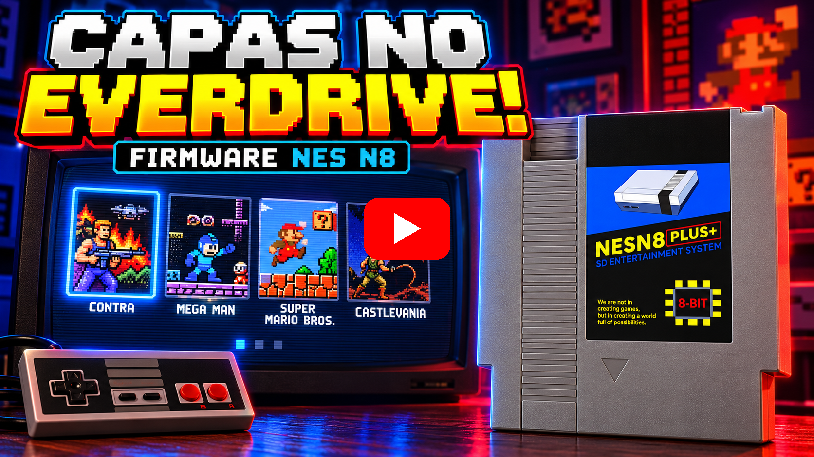

  <a href="./README.md">Português</a> |
  <a href="./README-EN.md">English</a> |
  <strong>Español</strong>

# Firmware personalizada para EverDrive NES N8

Este firmware muestra la **portada del juego** junto a la lista de juegos en el navegador del **EverDrive N8** para NES. Se creó un programa que convierte las imágenes de portada para NES y genera los archivos del firmware del cartucho (`OS.BIN` + `COVERS.BIN`), listos para copiar a la tarjeta SD.

## 🎥 Demostración en video

  

## Funciones del firmware y del programa

- Portada de **112×160 píxeles** a la derecha de la lista, con fondo y sprites de NES (hasta 62 sprites)
- **20 juegos por página**; la lista tiene la misma altura que la portada
- **← →** cambian de página con el cursor arriba (el firmware original mantenía la posición del cursor de la página anterior)
- La portada se carga solo cuando el cursor **se detiene** sobre un juego durante un tiempo configurable; cualquier botón cancela la carga
- Ajustes **por portada**: nitidez, tramado (*dithering*), parpadeo de sprites (7 niveles) y cambio de colores con cuentagotas
- Asociación automática ROM ↔ imagen por nombre de archivo
- Permite **añadir** portadas nuevas a un `COVERS.BIN` existente sin volver a convertir las anteriores

---

## Requisitos

- Un **EverDrive N8 clon** con la carpeta `EDFC` en la tarjeta SD.
- Imágenes de portada en formato **PNG** (consulta [Imágenes de portada](#imágenes-de-portada)).

> ⚠️ **Haz una copia de seguridad de la carpeta `EDFC` de la tarjeta antes de empezar**, especialmente del `OS.BIN` original. La herramienta escribe un `OS.BIN` modificado; para restaurar el original, vuelve a copiar tu copia de seguridad.

---

## Instalación

1. Descarga `NES N8 Covers Editor.zip` desde la página de *Releases*.
2. Descomprímelo en cualquier carpeta.
3. Abre **`NES N8 Covers Editor.exe`**.

Nota: La caché de la herramienta se guarda en **`%APPDATA%\NES N8 Covers editor\`**.

---

## Cómo usar

### 1. Portadas, ROMs y carpeta de salida
- **Carpeta de portadas (PNG):** carpeta que contiene las imágenes.
- **Carpetas de ROMs (.nes):** donde están tus ROMs. Puedes seleccionar la propia tarjeta SD (por ejemplo, `F:\`); también se leen las subcarpetas. Cada ROM se asocia con la imagen cuyo nombre más se parece.
- **Carpeta de salida:** donde se genera el firmware.
- **Añadir solo portadas nuevas a COVERS.BIN:** selecciona un `COVERS.BIN` que ya hayas generado. Las portadas existentes se conservan y solo se convierten las ROMs nuevas. Se guarda una copia del archivo anterior como `<salida>\COVERS_anterior.BIN`.

En la lista de la izquierda, **“Mostrar solo portadas de mis ROMs”** filtra las imágenes que se usarán, y **“Ver ROMs sin portada…”** muestra las ROMs que no encontraron una imagen.

### 2. Vista previa de la portada
Haz clic en una portada de la lista para ver cómo se verá en NES.

| Opción | Qué hace |
|---|---|
| **Espera antes de cargar la portada** | Tiempo que el cursor debe permanecer sobre el nombre del juego para que se cargue la portada (de 0 a 4 s; valor predeterminado: 0,5 s). Se aplica a todas las portadas. |
| **Nitidez** (10–200 %) | Realza los bordes al reducir la imagen. **Establecer como predeterminado** se aplica a las portadas sin ajuste propio. |
| **Tramado** (*dithering*) | Mezcla dos colores en un patrón de tablero para los degradados (cielo, piel, sombras). Se ve mejor en televisores CRT o con video compuesto; el patrón puede notarse con cables muy nítidos. |
| **Parpadeo de sprites** + **nivel** | Los sprites alternan entre dos cuadros cada 1/60 s y el ojo los mezcla, logrando más colores y detalle. El nivel 1 ofrece más fidelidad, pero parpadea más; el nivel 7 parpadea menos. El efecto depende del televisor. |
| **Paletas de esta portada / cuentagotas** | Haz clic en un color de la portada o en una muestra de la paleta para cambiarlo por un color de NES. **Deshacer** y **Restaurar originales** revierten los cambios. |
| **Mostrar / zoom** | Solo cambia la vista previa (cuadros alternos como en NES, su promedio o cada cuadro por separado). |

**Establecer como predeterminado** y **Usar el predeterminado en esta portada** controlan el parpadeo (activado/desactivado y nivel). Los iconos de la lista indican portadas con **nitidez** o **colores editados**; junto al nombre aparecen “flicker” y “dithering” cuando están activados.

### 3. Generar
1. Haz clic en **GENERAR FIRMWARE**. Se crean `<salida>\EDFC\OS.BIN` y `<salida>\EDFC\COVERS.BIN` (y las vistas previas en `<salida>\previews`).
2. Copia los archivos a la tarjeta con **Copiar ahora**, o usa **Añadir ruta…** para seleccionar la tarjeta SD y escribir el firmware directamente al generarlo.

> ⚠️ **Usa siempre “Copiar ahora” (o la ruta de la tarjeta SD).** EverDrive lee `COVERS.BIN` directamente desde los sectores de la tarjeta, por lo que el archivo debe estar **contiguo** (sin fragmentación). Si Windows lo copia en varios fragmentos, la consola puede **bloquearse al abrir una carpeta**. El botón elimina el archivo anterior, escribe uno contiguo y lo verifica.

> `OS.BIN` y `COVERS.BIN` deben usarse juntos: copia siempre ambos archivos de la misma generación.

### En la consola
- Detén el cursor sobre un juego; después de la espera, se carga su portada (aproximadamente un segundo).
- Si pulsas cualquier botón durante la carga, se cancela; volverá a empezar cuando el cursor se detenga otra vez.

---

## Imágenes de portada

- Formato **PNG**, de cualquier tamaño. La imagen se recorta desde el centro con una proporción de **0,7** (ancho/alto, como una caja de NES) y se reduce a 112×160. Las imágenes que ya tienen esa proporción no pierden nada.
- El nombre de la imagen debe ser el del juego (por ejemplo, `Contra (USA).png`). No tiene que coincidir exactamente con el nombre de la ROM: la herramienta busca el nombre más parecido (`001 Contra (U).nes` puede asociarse con `Contra (USA).png`). Varias ROMs pueden usar la misma imagen.
- Los conjuntos *Named_Boxarts* del proyecto [libretro-thumbnails](https://github.com/libretro-thumbnails/Nintendo_-_Nintendo_Entertainment_System) son una buena fuente de imágenes con este formato de nombres.

---

## Límites

| Límite | Valor | Motivo |
|---|---|---|
| Portadas por `COVERS.BIN` | **1015 ROMs** | El firmware usa una dirección de 16 bits para cada portada en la tarjeta. Cada ROM cuenta, aunque varias usen la misma imagen. |
| Elementos por carpeta de la tarjeta | **254** (archivos + subcarpetas) | Límite del firmware original del cartucho: el navegador deja de leer al llegar a ese número. Para colecciones más grandes, divide las ROMs en subcarpetas (por ejemplo, `A-F`, `G-M`, …). |
| Tamaño de `COVERS.BIN` | **32 KB por ROM** | 822 ROMs ≈ 26 MB. |
| Tipos de ROM con portada | solo **`.nes`** | |
| Nombre de ROM | hasta **60 caracteres**, **sin acentos** | El navegador muestra los nombres en 2 líneas de 30 caracteres; los nombres con acentos o más largos se omiten (aparece un aviso en el registro). |
| Nombre de ROM | debe empezar con **mayúscula** | Un nombre completamente en minúsculas (por ejemplo, `contra.nes`) aparece mal en el navegador del cartucho (`contanes`) y la portada no se carga. Usa `Contra.nes`. |
| Espera antes de cargar | **0 a 4 s** | |

---

## Colores y calidad

NES tiene una paleta fija y pocos colores por zona de la pantalla. En el área de la portada:

- **Fondo:** 2 paletas de 3 colores elegidos para cada portada (más el negro), una paleta por bloque de 16×16 píxeles.
- **Sprites:** 62 sprites con 4 paletas de 3 colores, hasta 8 por línea.
- **Colores fijos:** el negro del fondo, los colores del texto de la lista y el blanco/gris de la barra pertenecen al firmware (la lista también los usa) y no se pueden cambiar con el cuentagotas.

El **parpadeo** es lo que más mejora la fidelidad (la alternancia duplica los colores de los sprites); el **tramado** ayuda con los degradados. Convertir una portada tarda aproximadamente 1 s sin parpadeo y 12 s con parpadeo. Las vistas previas calculan los 7 niveles en segundo plano y muestran una barra de progreso.

---

## Problemas conocidos

- **La consola se bloquea al abrir una carpeta:** `COVERS.BIN` quedó fragmentado en la tarjeta, o `OS.BIN` y `COVERS.BIN` son de generaciones distintas. Vuelve a copiar ambos con **Copiar ahora**.
- **El nombre del juego aparece unido (por ejemplo, `contanes`) y la portada no se carga:** el nombre del archivo ROM está todo en minúsculas. Renómbralo empezando con mayúscula (`contra.nes` → `Contra.nes`).
- **Aparece una “interferencia” visual de ~0,5 s al encender la consola**, antes de la pantalla de carga: el firmware prepara la memoria de video en varios bancos y desaparece por sí sola.
- **Las carpetas con más de 254 elementos** muestran solo los primeros (límite del firmware original).
- Si el parpadeo de sprites se nota demasiado en tu televisor, desactívalo para esa portada (o elige un nivel más alto) y vuelve a generar los archivos.

---

## Créditos

Creado por **TavinhoGames** — [GitHub](https://github.com/Guga-Tavinho) · [Instagram](https://www.instagram.com/tavinho.games) · [YouTube](https://www.youtube.com/@tavinho-games)

Proyecto de fans, sin relación con Nintendo ni con los fabricantes de EverDrive. Las portadas de los juegos pertenecen a sus respectivos propietarios y no se distribuyen con el programa. Úsalo bajo tu propia responsabilidad y conserva una copia de seguridad de tu carpeta `EDFC`.
